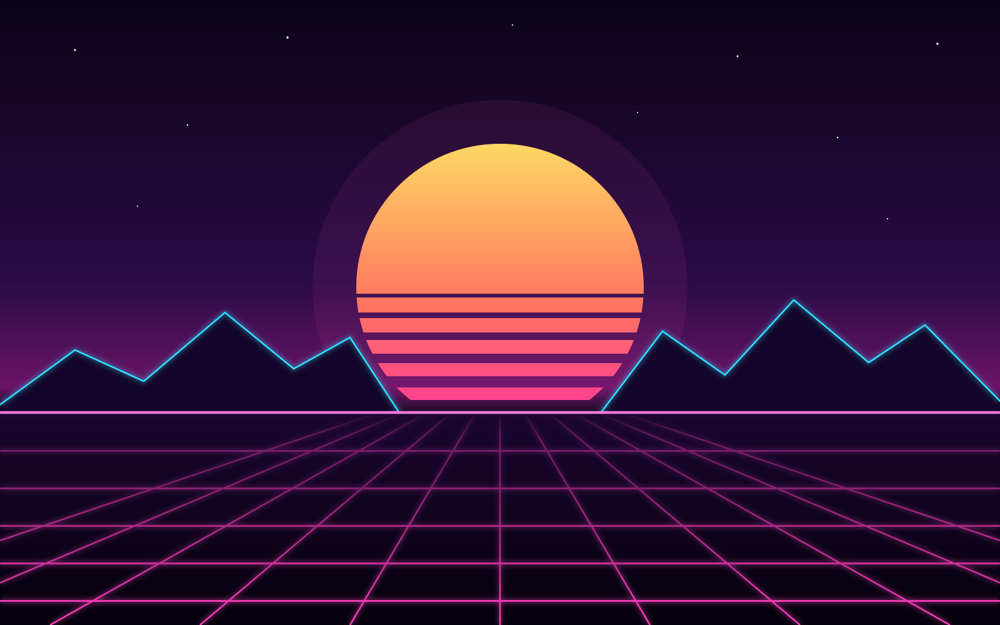
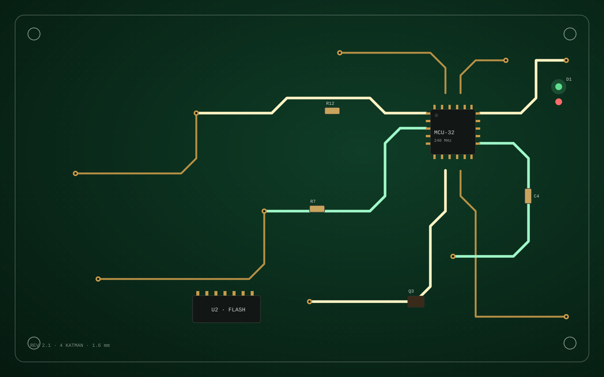
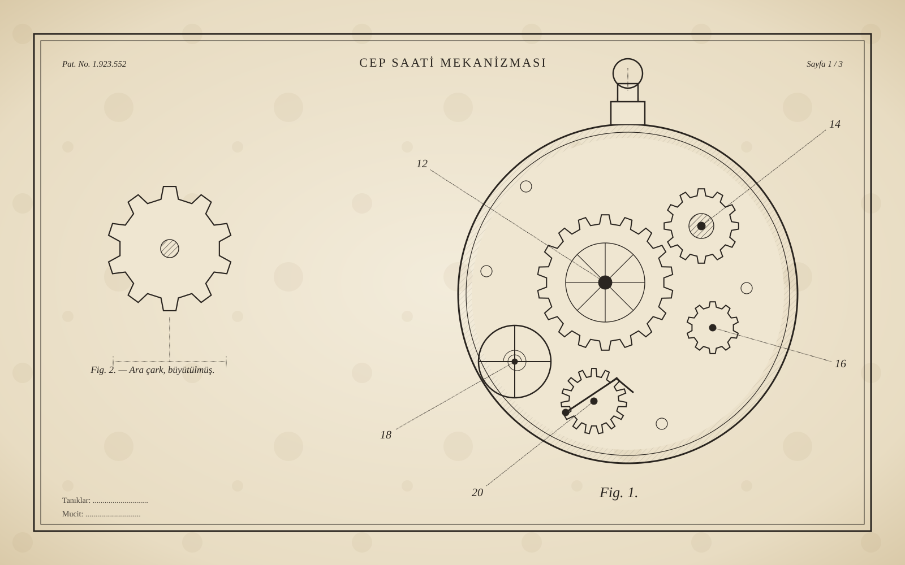

<div align="center">


<br>

**17 hand-crafted themes with animated backdrops for the Claude Code desktop and mobile apps.**<br>
One plugin, one command: `/tema`

<br>


[](LICENSE)

[Gallery](#-gallery) · [Installation](#-installation) · [Usage](#-usage) · [How it works](#-how-it-works) · [Troubleshooting](#-troubleshooting)

</div>

---

## ✨ Highlights

- **17 original themes** — every theme ships its own color palette and its own animated scene, all hand-drawn vector art.
- **Instant switching** — type `/tema neon` and the look changes on the spot; no new conversation needed.
- **Remembers your pick** — the chosen theme is saved, and new conversations open with it.
- **Light and dark** — nine themes support both modes and their scenes change at night (stars come out, windows light up). Seven are designed for dark mode and one, Patent, for light mode.
- **Readability first** — every palette passes a contrast check, and panels stay legible over the backdrop behind a light frosted glass.
- **Lightweight and safe** — scenes are pure SVG and CSS: no scripts, nothing loaded from the network. Animations pause when the system's "reduce motion" setting is on.

---

## 🖼 Gallery

> The previews are the actual scenes — you can see them animate right here.

<table>
<tr>
<td width="33%" align="center"><br><b>Kapadokya</b><br><sub>Hot-air balloons rising over fairy chimneys</sub><br><code>/tema kapadokya</code> · ☀️🌙</td>
<td width="33%" align="center"><br><b>Neon Gece</b><br><sub>Striped neon sunset and a scrolling grid</sub><br><code>/tema neon</code> · 🌙</td>
<td width="33%" align="center"><br><b>Aurora</b><br><sub>Slowly drifting northern lights</sub><br><code>/tema aurora</code> · 🌙</td>
</tr>
<tr>
<td align="center"><br><b>Nakkaşhane</b><br><sub>Ottoman-miniature city, riders and an illuminated frame</sub><br><code>/tema nakkas</code> · ☀️🌙</td>
<td align="center"><br><b>Lale Bahçesi</b><br><sub>Iznik tiles and tulips swaying in the wind</sub><br><code>/tema lale</code> · ☀️🌙</td>
<td align="center"><br><b>Derin Deniz</b><br><sub>Glowing jellyfish and rising bubbles</sub><br><code>/tema derin</code> · 🌙</td>
</tr>
<tr>
<td align="center"><br><b>Kış Ormanı</b><br><sub>Snowy pines, a smoking chimney and falling snow</sub><br><code>/tema kis</code> · ☀️🌙</td>
<td align="center"><br><b>Mürekkep</b><br><sub>Ink-wash mountains, mist and a red seal</sub><br><code>/tema murekkep</code> · ☀️🌙</td>
<td align="center"><br><b>Mavi Kopya</b><br><sub>A blueprint that draws itself, with turning gears</sub><br><code>/tema mavi</code> · 🌙</td>
</tr>
<tr>
<td align="center"><br><b>Bauhaus</b><br><sub>A geometric composition in primary colors</sub><br><code>/tema bauhaus</code> · ☀️🌙</td>
<td align="center"><br><b>Yörünge</b><br><sub>Orbiting planets and a starfield</sub><br><code>/tema yorunge</code> · 🌙</td>
<td align="center"><br><b>Topografya</b><br><sub>A contour map with a route that draws itself</sub><br><code>/tema topo</code> · ☀️🌙</td>
</tr>
</table>

### Blueprint collection

Technical drawings that draw themselves — dimension lines, callouts and title blocks, each from a different discipline.

<table>
<tr>
<td width="33%" align="center"><br><b>Mavi Kopya</b><br><sub>Classic cyanotype blueprint with turning gears</sub><br><code>/tema mavi</code> · 🌙</td>
<td width="33%" align="center"><br><b>Mimari Plan</b><br><sub>A diazo-print floor plan with swinging doors</sub><br><code>/tema mimari</code> · ☀️🌙</td>
<td width="33%" align="center"><br><b>Devre Kartı</b><br><sub>A circuit board with signals racing along copper traces</sub><br><code>/tema devre</code> · 🌙</td>
</tr>
<tr>
<td align="center"><br><b>Patent</b><br><sub>A vintage patent drawing of a ticking pocket-watch movement</sub><br><code>/tema patent</code> · ☀️</td>
<td align="center"><br><b>Roket Kesiti</b><br><sub>A rocket cutaway with a flight path that draws itself</sub><br><code>/tema roket</code> · 🌙</td>
<td align="center"><br><b>Mühendislik Defteri</b><br><sub>A pencil truss-bridge calculation on graph paper</sub><br><code>/tema defter</code> · ☀️🌙</td>
</tr>
</table>

<sub>☀️🌙 light and dark mode · 🌙 designed for dark mode · ☀️ designed for light mode</sub>

---

## 📦 Installation

### Claude Code desktop app

1. Click the **+** button next to the message box and choose **Plugins**.
2. Click **Add marketplace** and enter `darksoftinc/claude-themes`.
3. Add the **tema** plugin from the list.
4. Start a new conversation — it opens with the default theme, **Kapadokya**.

### Terminal

Inside a Claude Code session:

```text
/plugin install tema --marketplace darksoftinc/claude-themes
```

or straight from your shell:

```bash
claude plugin install tema --marketplace darksoftinc/claude-themes
```

> [!NOTE]
> Themes are drawn by the desktop and mobile apps. The terminal and editor extensions don't draw backdrops; the command still works there and saves your choice.

---

## 🎛 Usage

| Command | What it does |
|---|---|
| `/tema` | Lists every theme and marks the active one with ● |
| `/tema <name>` | Switches to that theme right away and saves the choice |
| `/tema kapali` | Turns theming off and returns to the app's own look |

You don't need the full name — the first letters are enough, and Turkish characters are optional:

```text
/tema neon          → Neon Gece
/tema kis ormani    → Kış Ormanı
/tema yor           → Yörünge
```

> The command's own messages are in Turkish.

---

## 🧩 How it works

The plugin is a single hooks module built on Claude Code's plugin interface:

1. **At session start** it reads the saved theme and sends the app its color palette and scene.
2. **The palette** grows a handful of seed colors (surfaces, text tones, accent, danger, success and warning) into the design system's full set of color tokens, checked for contrast.
3. **The scene** is a single SVG drawn behind the conversation. Animations are CSS inside the SVG; dark mode reaches the scene through `prefers-color-scheme`.
4. **The `/tema` command** writes your choice to persistent storage and re-applies the theme immediately.

```text
.
├── .claude-plugin/
│   ├── plugin.json        # plugin manifest
│   └── marketplace.json   # makes this repo an install source
├── hooks/
│   ├── hooks.json         # names the module
│   ├── register.tsx       # the 17 themes and the /tema command
│   ├── make-colors.js     # expands a palette into design-system tokens
│   └── tema.test.tsx      # tests for the command
└── assets/                # README images
```

---

## 🛠 Troubleshooting

<details>
<summary><b>The theme doesn't show up</b></summary>

- Make sure you're in the desktop or mobile app — the terminal doesn't draw backdrops.
- Start a **new conversation** after installing; plugins load when a conversation starts.
- Themes marked 🌙 look their best in dark mode.

</details>

<details>
<summary><b>Two themes are mixing</b></summary>

Only one theme plugin should be enabled at a time. If you installed this repo from more than one source, or have another theme plugin, leave just one enabled in the **Plugins** menu.

</details>

<details>
<summary><b>Text is hard to read over the backdrop</b></summary>

Try a calmer theme (`/tema murekkep`, `/tema topo`), or go back to the app's own look with `/tema kapali`.

</details>

<details>
<summary><b>Uninstalling</b></summary>

```bash
claude plugin uninstall tema@claude-themes
```

</details>

---

<div align="center">
<sub>Every scene was drawn originally for this project · Released under the <a href="LICENSE">MIT License</a>.</sub>
</div>
