<div align="center">



<br>

**Claude Code masaüstü ve mobil uygulaması için el yapımı, hareketli arka planlı 12 tema.**<br>
Tek bir eklenti, tek bir komut: `/tema`

<br>


[Galeri](#-galeri) · [Kurulum](#-kurulum) · [Kullanım](#-kullanım) · [Nasıl çalışır](#-nasıl-çalışır) · [Sorun giderme](#-sorun-giderme)

</div>

---

## ✨ Öne çıkanlar

- **12 özgün tema** — Her temanın kendi renk paleti ve kendi hareketli sahnesi var. Hepsi elle çizilmiş vektör grafikler.
- **Anında geçiş** — `/tema neon` yazdığınız anda görünüm değişir; yeni sohbet açmanız gerekmez.
- **Hatırlanan seçim** — Seçtiğiniz tema saklanır, yeni sohbetler de aynı temayla açılır.
- **Gündüz ve gece** — Yedi tema iki modu da destekler; sahne gece moduna göre değişir (yıldızlar çıkar, pencereler yanar). Beşi koyu mod için tasarlandı.
- **Okunabilirlik önce gelir** — Bütün paletler kontrast denetiminden geçer; paneller arka planın üstünde hafif buzlu camla okunur kalır.
- **Hafif ve güvenli** — Sahneler saf SVG ve CSS'tir: script çalıştırmaz, dışarıdan hiçbir şey yüklemez. Sistemde "hareketi azalt" açıksa animasyonlar durur.

---

## 🖼 Galeri

> Önizlemeler gerçek sahnelerin kendisidir; animasyonlarını burada da görebilirsiniz.

<table>
<tr>
<td width="33%" align="center"><br><b>Kapadokya</b><br><sub>Peribacaları üzerinde yükselen balonlar</sub><br><code>/tema kapadokya</code> · ☀️🌙</td>
<td width="33%" align="center"><br><b>Neon Gece</b><br><sub>Çizgili neon gün batımı ve kayan ızgara</sub><br><code>/tema neon</code> · 🌙</td>
<td width="33%" align="center"><br><b>Aurora</b><br><sub>Dalgalanan kuzey ışıkları</sub><br><code>/tema aurora</code> · 🌙</td>
</tr>
<tr>
<td align="center"><br><b>Nakkaşhane</b><br><sub>Minyatür üslubunda şehir, atlılar, tezhipli çerçeve</sub><br><code>/tema nakkas</code> · ☀️🌙</td>
<td align="center"><br><b>Lale Bahçesi</b><br><sub>İznik çinisi ve rüzgârda sallanan laleler</sub><br><code>/tema lale</code> · ☀️🌙</td>
<td align="center"><br><b>Derin Deniz</b><br><sub>Işıltılı denizanaları ve kabarcıklar</sub><br><code>/tema derin</code> · 🌙</td>
</tr>
<tr>
<td align="center"><br><b>Kış Ormanı</b><br><sub>Karlı çamlar, tüten baca, kar yağışı</sub><br><code>/tema kis</code> · ☀️🌙</td>
<td align="center"><br><b>Mürekkep</b><br><sub>Mürekkep lekesi dağlar, sis ve mühür</sub><br><code>/tema murekkep</code> · ☀️🌙</td>
<td align="center"><br><b>Mavi Kopya</b><br><sub>Kendini çizen teknik çizim ve dişliler</sub><br><code>/tema mavi</code> · 🌙</td>
</tr>
<tr>
<td align="center"><br><b>Bauhaus</b><br><sub>Ana renklerde geometrik kompozisyon</sub><br><code>/tema bauhaus</code> · ☀️🌙</td>
<td align="center"><br><b>Yörünge</b><br><sub>Dönen gezegenler ve yıldız alanı</sub><br><code>/tema yorunge</code> · 🌙</td>
<td align="center"><br><b>Topografya</b><br><sub>Eş yükselti eğrili harita ve kendini çizen rota</sub><br><code>/tema topo</code> · ☀️🌙</td>
</tr>
</table>

<sub>☀️🌙 gündüz ve gece modu · 🌙 koyu mod için tasarlandı</sub>

---

## 📦 Kurulum

### Claude Code masaüstü uygulaması

1. Mesaj kutusunun yanındaki **+** düğmesine tıklayın ve **Plugins**'i seçin.
2. **Add marketplace**'e tıklayıp `darksoftinc/claude-themes` yazın.
3. Listeden **tema** eklentisini ekleyin.
4. Yeni bir sohbet açın: varsayılan tema **Kapadokya** ile başlar.

### Terminal

Bir Claude Code oturumunun içinde:

```text
/plugin install tema --marketplace darksoftinc/claude-themes
```

ya da doğrudan kabukta:

```bash
claude plugin install tema --marketplace darksoftinc/claude-themes
```

> [!NOTE]
> Temalar masaüstü ve mobil uygulamada çizilir. Terminal ve editör eklentileri arka plan çizmez; komut orada da çalışır ve seçiminizi kaydeder.

---

## 🎛 Kullanım

| Komut | Ne yapar |
|---|---|
| `/tema` | Bütün temaları listeler, açık olanı ● ile işaretler |
| `/tema <ad>` | O temaya hemen geçer ve seçimi kaydeder |
| `/tema kapali` | Temayı kapatır, uygulamanın kendi görünümüne döner |

Adın tamamını yazmanız gerekmez, baş harfleri yeter. Türkçe karakterler de tanınır:

```text
/tema neon          → Neon Gece
/tema Kış Ormanı    → Kış Ormanı
/tema yor           → Yörünge
```

---

## 🧩 Nasıl çalışır

Eklenti, Claude Code'un eklenti arayüzünü kullanan tek bir hooks modülüdür:

1. **Oturum başında** kayıtlı temayı okur ve uygulamaya renk paletiyle sahneyi gönderir.
2. **Renk paleti** birkaç ana renkten (yüzeyler, metin tonları, vurgu, tehlike, başarı ve uyarı renkleri) tasarım sisteminin bütün renk değerlerine genişletilir ve kontrast için denetlenir.
3. **Sahne**, konuşmanın arkasına çizilen tek bir SVG'dir. Animasyonlar SVG'nin içindeki CSS ile yapılır; gece modu sahneye `prefers-color-scheme` üzerinden yansır.
4. **`/tema` komutu** seçimi kalıcı depoya yazar ve temayı o anda yeniden uygular.

```text
.
├── .claude-plugin/
│   ├── plugin.json        # eklenti bilgisi
│   └── marketplace.json   # bu deponun kurulum kaynağı olması için
├── hooks/
│   ├── hooks.json         # modülün adı
│   ├── register.tsx       # 12 tema ve /tema komutu
│   ├── make-colors.js     # paleti tasarım sistemi renklerine genişletir
│   └── tema.test.tsx      # komutun testleri
└── assets/                # README görselleri
```

---

## 🛠 Sorun giderme

<details>
<summary><b>Tema görünmüyor</b></summary>

- Masaüstü veya mobil uygulamada olduğunuzdan emin olun; terminal arka plan çizmez.
- Kurulumdan sonra **yeni bir sohbet** açın; eklentiler sohbet başlarken yüklenir.
- Koyu mod için tasarlanmış temalar (🌙) en iyi koyu modda görünür.

</details>

<details>
<summary><b>İki tema birbirine karışıyor</b></summary>

Aynı anda yalnızca bir tema eklentisi açık olmalı. Bu depoyu birden fazla kaynaktan kurduysanız ya da başka bir tema eklentiniz varsa, **Plugins** menüsünden yalnızca birini açık bırakın.

</details>

<details>
<summary><b>Yazılar arka planın üstünde zor okunuyor</b></summary>

Daha sade bir tema deneyin (`/tema murekkep`, `/tema topo`) ya da `/tema kapali` ile uygulamanın kendi görünümüne dönün.

</details>

<details>
<summary><b>Kaldırma</b></summary>

```bash
claude plugin uninstall tema@claude-themes
```

</details>

---

<div align="center">
<sub>Bütün sahneler bu proje için özgün olarak çizilmiştir.</sub>
</div>
